# development-skills

A Claude Code plugin that turns your AI agent into a disciplined software engineer.

<a href="https://github.com/reidemeister94/development-skills/releases"></a>
<a href="LICENSE"></a>
<a href="https://github.com/reidemeister94/development-skills/stargazers"></a>

---

## Installation

### Claude Code

```bash
/plugin marketplace add reidemeister94/development-skills
/plugin install development-skills@development-skills
```

Activates automatically on any coding task. No configuration needed.

### Codex

This repo now also ships Codex plugin manifests under `plugins/*/.codex-plugin/plugin.json` and a Codex marketplace catalog at `.agents/plugins/marketplace.json`.

The packaged structure is available to Codex, but some skill bodies still contain Claude-specific instructions and may need follow-up adaptation for perfect runtime parity.

---



## What It Does

AI agents are fast but undisciplined — [67% of developers](https://addyo.substack.com/p/the-80-problem-in-agentic-coding) spend *more* time debugging AI-generated code than writing it. This plugin enforces a mandatory gated workflow: research before planning, plan before coding, test before shipping, review before merging. Every time.

Each session starts with a short development loop: read the project's standards, settle open decisions, make the smallest useful change, verify it, and report what wasn't checked. A small task goes straight to the edit and the check. Work that needs a lasting record gets a plan and a chronicle. A read-only **Staff Reviewer** agent reviews code on request.

---

## Plans and Chronicles

Work that needs a lasting record produces files on disk. Context windows get compacted. These files don't.

**Plan files** (`docs/plans/2026-03-15__auth-refactor.md`) are the single source of truth for a task. They record the steps and verification results. When the context window clears, the agent picks up where it left off by reading the plan.

**Chronicles** (`docs/chronicles/2026-03-15__auth-refactor.md`) capture what code and plans don't — **WHY**. The user's original request, the business context behind it, rejected alternatives, discoveries made during implementation. Without chronicles, a conversation with Claude disappears when the session ends. With chronicles, the reasoning survives: why cursor-based pagination instead of offset, why the auth middleware was rewritten, why a simpler approach was rejected.

```
Code + Git    →  WHAT changed    (diffs)
Plan files    →  HOW it was built (steps, checklist, verification)
Chronicles    →  WHY it happened  (intent, context, decisions)
```

Full details on templates and lifecycle in the **[in-depth guide](docs/GUIDE.md)**.

---

## Skill Highlights

This section highlights commonly used skills in the `development-skills` plugin and is not an exhaustive inventory.

**Workflow** — `using-development-skills` (auto-activates), `brainstorming`, `debugging`, `chronicles`

**Languages** — `python-dev`, `java-dev`, `typescript-dev`, `frontend-dev`, `swift-dev`

**Testing** — `create-test`, `eval-regression`

**Utilities** — `commit`, `simplify-stuff`, `align-docs`, `create-skills`, `get-api-docs`, `update-precommit`, `update-reqs` (use `requirements-dev.in` for dev deps)

Auto-format on save via hooks: ruff (Python), biome (JS/TS), google-java-format, swift-format, prettier.

Full details in the **[in-depth guide](docs/GUIDE.md)**.

---

## Acknowledgments

Draws inspiration from [superpowers](https://github.com/obra/superpowers) by Jesse Vincent — spec-first brainstorming, subagent-per-task dispatch with two-stage review, bite-sized TDD plans, and git worktree isolation.

Where development-skills diverges: **language-specific engineering patterns** (5 languages with framework-level guidance), **context engineering** (observation masking, progressive phase loading), and a **chronicles** layer for capturing WHY decisions were made.

---

## Further Reading

- [How I Taught Agents to Follow a Process, Not Just Write Code](https://medium.com/@silvio.pavanetto/how-i-taught-agents-to-follow-a-process-not-just-write-code-b135b6573c54) — the full story
- [Effective Context Engineering for AI Agents](https://www.anthropic.com/engineering/effective-context-engineering-for-ai-agents) — the patterns we implement
- [TDD, AI Agents and Coding with Kent Beck](https://newsletter.pragmaticengineer.com/p/tdd-ai-agents-and-coding-with-kent) — why testing matters more with AI

---

## Contributing

Contributions welcome — especially new language skills (Rust, Go, Kotlin, Ruby, C#). See [CONTRIBUTING.md](CONTRIBUTING.md).

No PR without a passing `/eval-regression`. Open an issue first.

## Fork Maintenance

This fork deliberately diverges from `reidemeister94/development-skills` and keeps the `plugins/` layout. Sync is one-way, upstream to here:

- Never open PRs or push to upstream.
- Never run `git merge upstream/main`: the histories are unrelated and the layouts differ.
- Sync skills with `make sync-upstream`, which adds new skills and updates those without local edits. Skills listed in `scripts/upstream-skip` are never touched, and `scripts/upstream-base` records the last synced commit.

Run on each machine after cloning. It symlinks `global/CLAUDE.md`, downloads the skills listed in `global/skills.txt` from their authors, and makes the `upstream` remote fetch-only. Rerun it to update those skills:

```bash
make setup
```

To bring in upstream skills, keeping the `plugins/` layout:

```bash
make sync-upstream
git diff
```

This adds new skills and updates those without local edits. A skill edited both here and upstream is kept and reported. Add a skill to `scripts/upstream-skip` to keep your version permanently.

## License

MIT
